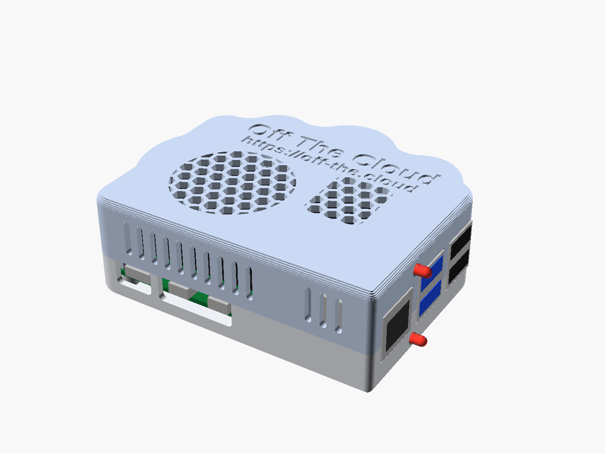
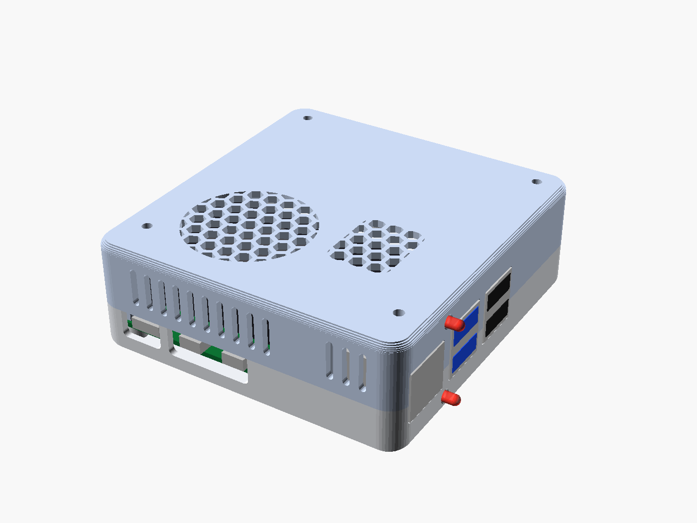

# Cases to print

3D-printable cases for the Off The Cloud device: a Raspberry Pi 5 with the GeeekPi/52Pi
**Armor Lite V5** heatsink-fan (in place of the Active Cooler) and the two status LEDs.
Both are parametric [OpenSCAD](https://openscad.org) sources with ready-to-print STLs, print
without supports, and use the same hardware: M2.5x4 heat-set inserts and M2.5 screws.

| | |
|---|---|
| [**Cloud case**](cloud-case/) - for a shelf or a desk: a cloud-shaped case with "Off The Cloud" and https://off-the.cloud on top, the two USB drives plugged into the blue ports outside |  |
| [**Screen case**](screen-case/) - for the wall: screws onto the back of a portable screen with 75 x 75 mm M2.5 holes and hangs it on the wall by two keyholes; the Pi's HDMI goes to the screen |  |

Each folder has its source (`.scad`), the STLs in printing orientation, small test pieces to
print first, previews, and a README with the hardware list, print settings and assembly.
`render.sh` in each regenerates the STLs and previews and runs the interference checks
against a reference model of the Pi 5, the cooler and the LEDs.

The designs are under [CC BY-SA 4.0](LICENSE.md), not the AGPL of the rest of the repository.
