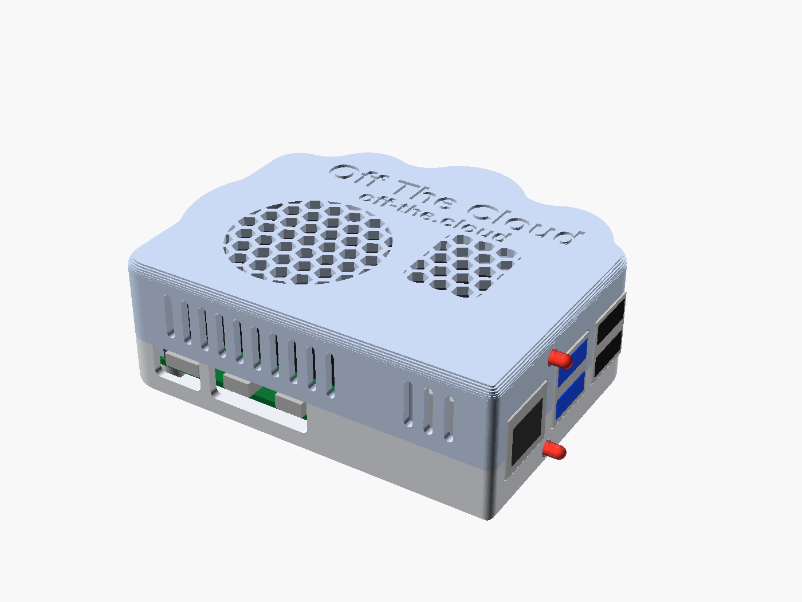
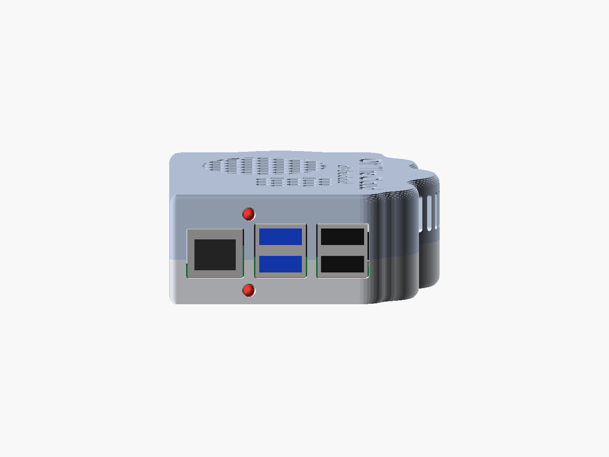
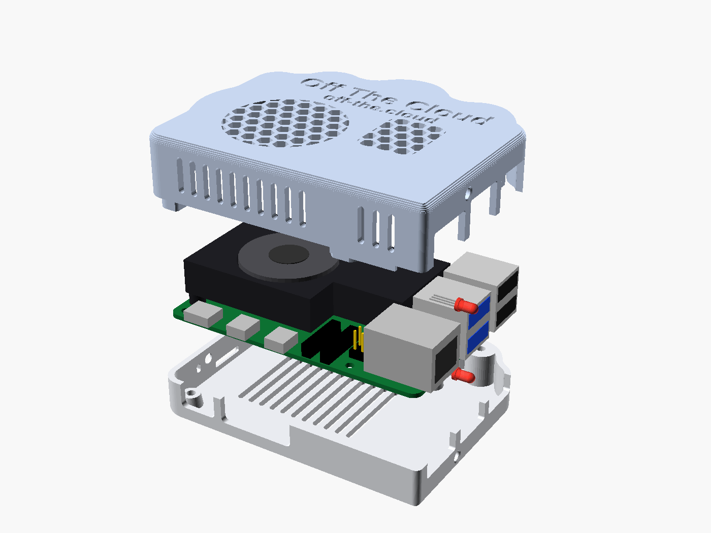
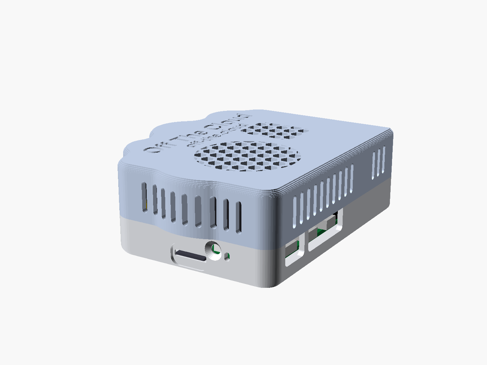

# Off The Cloud case for the Raspberry Pi 5 + Armor Lite V5

A two-part, cloud-shaped case for the Off The Cloud device: a Raspberry Pi 5 with the
GeeekPi/52Pi **Armor Lite V5** heatsink-fan, two mirrored USB disks plugged into the
**blue USB 3.0 ports**, and two bi-colour 3 mm status LEDs (one per mirror member,
driven by `scripts/raid_watch.py`) on the line of the gap between the Ethernet jack and the
blue ports: one above the ports in the lid, one below them in the base.

| USB end: the two status LEDs above and below the gap between the Ethernet jack and the blue stack | Lid: cloud outline, fan grille, text |
|---|---|
|  |  |
| **Exploded: base, Pi 5 + Armor Lite V5, lid** | **Port bay under the left lobe: microSD, power button, status LED** |
|  |  |

## Files

| File | What it is |
|---|---|
| `otc-case.scad` | Parametric OpenSCAD source (every size is a named variable at the top) |
| `otc-case-base.stl` | Base, already in printing orientation (upright) |
| `otc-case-lid.stl` | Lid, already in printing orientation (upside down, top on the bed) |
| `otc-case-test-usb-wall.stl` | Test slice of the USB end wall (ports + both LED holes), prints flat in ~15 min |
| `otc-case-test-inserts.stl` | Test piece for the heat-set inserts: a lid back boss, a back Pi standoff and the end of the front-left lid boss, ~15 min |
| `render.sh` | Regenerates the STLs, the PNGs and the interference checks |
| `view-*.png` | Previews: `iso`, `usb-end` (with the Pi and LEDs), `usb-end-empty`, `port-side`, `microsd-bay`, `lid-top`, `exploded`, `cut-usb`, `cut-front`, `cut-side`, `base-inside`, `lid-print`, `bottom`, `test-usb-wall`, `test-inserts` |

Outside size: **93.8 x 78.0 x 31.9 mm** (W x D x H): the base is 13.1 mm tall, the lid 18.8 mm,
and the lid overhangs the base by 3 mm over the microSD end. Material: about 42 cm³ of
plastic (base 17 cm³, lid 24.5 cm³), about 50 g of PETG.

## The design in short

* **Cloud outline.** Seen from above the lid is a cloud: flat bottom (the USB-C/HDMI side),
  three bumps on top (the GPIO side) and a big round lobe on the left (the microSD end).
  The USB/Ethernet end is cut flat for the ports. The lobes are a list of circles
  (`lobes`), the valleys between them are rounded by `cusp_fillet`.
* **Port bay.** On the microSD end the base keeps a flat wall, so the card slot, power
  button and status-LED window stay right at the board edge, reachable with a finger;
  the lid's big left lobe overhangs this bay like a cloud. That lobe is solid plastic
  with straight vent slots right through it into the case (prints fine upside down, no
  bridges wider than 2 mm).
* **Base** (printed upright): floor, four standoffs for the Pi, walls up to just above
  the USB-C/HDMI plugs. Every port cut-out in it is a U-slot open at the top, so the
  board (with the cooler already fitted) drops straight in.
* **Lid** (printed upside down): top with the debossed **"Off The Cloud"** and, under it,
  **off-the.cloud** (0.7 mm deep, `text_on`, `url_on`), a round honeycomb grille over the fan and a second patch over the
  heatsink's right fins, vertical vent slots in the walls, the upper half of the
  USB/Ethernet openings, the upper LED, an alignment lip and the screw bosses.
* **Cooling.** The Armor Lite blows down into its fins, which run along the board, so the
  warm air leaves at both ends of the heatsink. Air in: lid grille (6.5 mm of free air
  above the fan) and floor slots; air out: slots in the left lobe, the top lobes and the
  front wall.

### Fastening (screws, no clips)

Screws are more reliable than printed clips here: the cloud's curved walls make clips
awkward, and PLA/PETG clips wear out. No screw head shows on top or on the sides.

One insert and one screw size everywhere: six **M2.5x4 heat-set inserts** (ø3.6 x 5 mm
holes, `insert_d`, `insert_depth`) and **M2.5 screws**, socket or button head, in two
lengths: **M2.5x6** for the two that go into the board from above, **M2.5x8** for the four
from below. M2.5 because the Pi's holes (ø2.7) take nothing bigger; two lengths because
an M2.5x8 from above would come out under the case, and an M2.5x6 from below would barely
reach the front inserts.

* Back of the Pi: **2 x M2.5x6** from above into **M2.5x4 heat-set inserts** in the two back
  standoffs (`pi_use_insert = false` makes them ø2.2 pilots for self-tapping screws
  instead). The four standoffs are the same smooth taper: 7.2 mm on the floor (1.8 mm of
  plastic round an insert) to 6 mm at the top, where the board rests, which is the Pi's
  keep-out round each mounting hole (`standoff_top_d`). 7.2 mm is as wide as the foot can
  be for the taper to stay 0.4 mm clear of the cooler's two screw heads under the board
  (`standoff_base_d`, from `standoff_d`, `cooler_head_d`, `cooler_head_h`).
* Front of the Pi: **2 x M2.5x8** (M2.5x10 also fits) from **below**,
  up through the base standoffs and the Pi's two front holes into **M2.5x4 heat-set
  inserts** in two bosses that come down from the lid. They hold the front of the board and
  the front of the lid at once (the front long side has no room for anything else: the
  board is 1 mm from the wall). The head sits in a ø5 pocket with 1.5 mm of plastic left
  under the board (`thru_tunnel`), and the screw goes 3.6 mm into the 4 mm insert.
* The front lid bosses are solid blocks against the front wall, the same shape from the
  ceiling down: a 10 mm circle round the hole (`pillar_d`, as the back ones) less the room
  the parts beside it need, 0.3 mm clear of them (`part_clear`), corners rounded
  (`thru_round`). The left one fills the front-left corner between the USB-C receptacle and
  the heatsink; the right one stops short of the camera/display connector and the PoE header.
  They have the same ø3.6 x 5 mm insert holes as the back standoffs (and a ø2.9 hole above
  for a longer screw), with 1.8-3.2 mm of plastic round an insert, and 1.15-1.4 mm on the
  side facing the USB-C receptacle, the heatsink or the PoE header, as at the top of the back
  standoffs. They end 1.5 mm above the board (`thru_gap`) and never touch it: the lid closes
  on the base, the back screws hold the board and the front ones locate it, and nothing on
  the board, nor a board or print a little thicker than drawn, can keep the lid from
  closing. `thru_use_insert = false` gives ø2.2 pilots for self-tapping screws instead.
* Back of the lid: **2 x M2.5x8** from below (M2.5x10 also fits), through pillars inside the
  two outer top lobes into **M2.5x4 heat-set inserts** in the lid's bosses. Pillars and
  bosses are 10 mm wide (`pillar_d`), with 3.2 mm of plastic round an insert. The screw
  head sits in a ø5 pocket that runs up the pillar to 4 mm under the joint (`lid_tunnel`),
  so the screw's other 4 mm fill the insert. `lid_use_insert = false` gives ø2.2 pilots
  for self-tapping screws instead.
* A 1.2 mm lip under the lid keys into the base on the port-free sides.

If the front-left lid boss turns out to touch the cooler (see "Check with a test print"),
correct the cooler's position (`al_x0`, `al_y_top`) and render again: the boss is cut to
clear it. Or set `lid_through_pi = [false, true]`: that hole then takes a normal M2.5x6
from above.

### The two status LEDs

On a Pi 5 the two blue USB 3.0 ports are **one vertical stack** (top and bottom port),
between the Ethernet jack and the black USB 2.0 stack. The LEDs sit on the line of the gap
between the Ethernet jack and that stack, one above the ports and one below them:

* **Top blue port -> the upper LED**, in the lid's end wall, above the ports: its hole is
  1 mm over the port cut-outs.
* **Bottom blue port -> the lower LED**, in the base's end wall, below the ports: its hole
  is 1.9 mm under the cut-outs, at the height of the space under the board.

They are ordinary **3 mm round bi-colour LEDs** (red/green, common cathode, 3 leads). Each
goes in a ø3.15 hole with a ø4 counterbore on the inside for its ~3.8 mm flange
(`led_bore`, `led_seat_d`, `led_seat_depth`), pushed in from inside; a drop of hot glue or
CA behind the wall holds it. (The gap itself is only 3.7 mm between the two metal shells,
too narrow for a 3 mm LED with its flange.) Other layouts: `led_layout = "between"` puts
two 2 x 5 mm rectangular LEDs upright in the gap, each beside its port, and
`"both_above"` two 3 mm LEDs above the blue stack, side by side.

Wiring (from `scripts/raid_watch.py`, BCM numbers; one resistor of 330-470 Ω in each
red and green lead, common cathode to ground):

| LED | red | green | cathode |
|---|---|---|---|
| LED 0 (array slot 0) | BCM 17 = pin 11 | BCM 27 = pin 13 | GND, e.g. pin 9 |
| LED 1 (array slot 1) | BCM 22 = pin 15 | BCM 23 = pin 16 | GND, e.g. pin 14 or 20 |

`raid_watch.py` lights an LED per **array slot**, not per port. Wire the upper LED as
LED 0 and the lower one as LED 1, then check in Settings › Logs (the storage log names
the USB port of each disk) which slot sits in which port; if they are crossed, swap the
two LED plugs on the header (or the pins in `CONFIG["leds"]`).

The leads: the upper LED's run back over the USB stacks to the GPIO header in the back
lobes, which leave 10-18 mm beside the header for DuPont plugs (inner height above the
board: 22.5 mm). The lower LED's run back under the board, 1.8 mm under it, between the
Ethernet jack's and the blue stack's pins: check the underside of your Pi behind that hole,
and if a pin is in the way, bend the leads down to the floor. Run its wires (thin ones:
the board is 4 mm above the floor, and the pins under the USB end stick out about 2 mm)
along the floor to the GPIO side, up past the board's edge (2 mm there, more in the lobes)
and to the header. Sleeve bare leads in heat-shrink: the jacks' shells are metal.

## Printing

| Setting | Value |
|---|---|
| Material | **PETG** (or ASA). PLA only if the device lives somewhere cool: the heatsink exhaust is warm and PLA softens around 55-60 °C |
| Nozzle / layer | 0.4 mm / 0.2 mm (0.16 mm gives crisper text) |
| Walls | 4 perimeters (the 2 mm walls then print solid) |
| Top / bottom | 5 layers |
| Infill | 20 % gyroid (pillars, bosses, the solid left lobe) |
| Supports | **None.** Overhangs are 45° or less; the only bridges are the tops of small holes and slots (13 mm at most) |
| Orientation | As exported: base upright; lid upside down (its top, with the text and the grille, on the bed); test slice flat on its outer face |
| Adhesion | No brim needed |
| Other | Elephant-foot compensation 0.1-0.2 mm keeps the debossed text and the lid edge crisp; a textured PEI sheet gives a nice top |

## Hardware

* 6 x M2.5x4 heat-set inserts: two in the base's back standoffs, four in the lid (its two
  front bosses and two back bosses). The holes are ø3.6: set `insert_d` to the hole size
  your inserts' maker gives.
* M2.5 screws, socket or button head: 2 x M2.5x6 (the back Pi holes, from above) and
  4 x M2.5x8 (the front Pi holes and the lid, from below; M2.5x10 also fits)
* 4 x self-adhesive rubber feet, ø10 mm (recesses ø10.5 x 0.8 mm); they also lift the
  floor vents off the table
* 2 x 3 mm round bi-colour red/green LEDs, common cathode (3 leads), 4 resistors 330-470 Ω,
  DuPont female jumper wires (thin wire for the lower LED's run under the board), heat-shrink
* the Armor Lite's own 2 screws (come with it). No metal standoffs: they are printed.

## Assembly

1. Fit the Armor Lite V5 to the Pi with its two screws from under the board (into the
   Pi 5's two cooler holes) and plug its fan into the FAN header.
2. Make up the LEDs with their resistors and wires.
3. Press the inserts in with a soldering iron, at the temperature the insert maker gives
   for your plastic, each flush with its surface: two into the base's back standoffs, and,
   with the lid upside down, two into the lid's front bosses (the two blocks by the flat
   wall, from their ends) and two into its back bosses (from the joint side). Go slowly on
   the front bosses' thin side, facing the board's parts.
4. Push the lower LED into its hole in the base's end wall from inside (dome out, flange in
   the counterbore, leads pointing in) and glue it; lay its wires along the floor towards
   the GPIO side.
5. Take the microSD card out. Lower the Pi into the base (ports into the U-slots), bring
   the lower LED's wires up past the board's GPIO edge, screw the two back M2.5x6 and plug
   the LED on the header.
6. Push the upper LED into its hole in the lid's end wall from inside and glue it; bend
   its leads back and up, and plug it on the header with some slack.
7. Lower the lid (its notches drop over the USB/Ethernet ports), turn the case over and
   drive the four M2.5x8: two in the front standoffs, two in the back lobes.
8. Slide the microSD card in through the slot in the bay (the finger recess lets you
   push and pull it), stick the feet on.

## Check with a test print first

Print `otc-case-test-usb-wall.stl` (the USB end wall, base and lid parts fused, with a
small ledge for the PCB edge; ~15 min, flat on the bed). Then:

1. Rest the USB end of the Pi on the ledge, prop the other end 6 mm up (the PCB sits
   6 mm above the table in the case), and slide the Ethernet and USB ports into the
   openings: each should go in with a small even gap (0.4 mm a side) and end flush with
   the outside face (0.2 mm proud). Adjust `port_clear` / `usb_proud` if not.
2. Push a 3 mm LED into each hole from the inside: snug, not forced, its flange in the
   counterbore. Adjust `led_bore` / `led_seat_d` for your printer and LEDs.
3. Measure your Armor Lite: height of the fan above the PCB (the case assumes 15 mm +
   1 mm fan, with 6.5 mm of air above), the fan centre measured from the Pi's front-left
   mounting hole (assumed 23.5 mm along the board, 20.9 mm across), and the distance from
   that mounting hole to the heatsink's nearest edge (the case assumes 3.3 mm: the lid
   boss is cut 0.3 mm clear of it, leaving 1.2 mm of plastic round the insert on that
   side; below 3.0 mm set `lid_through_pi = [false, true]`). Correct `al_total_h`,
   `fan_c`, `al_x0`, `al_y_top` if they differ.
4. Look at the board round the two front mounting holes: nothing on it may stand taller
   than 1.2 mm within 5 mm of a hole (the lid bosses end 1.5 mm over the board there; the
   USB-C receptacle, the heatsink and the PoE header are already allowed for). Raise
   `thru_gap` if something does.

Then print `otc-case-test-inserts.stl` (~15 min, flat as exported): a lid back boss (10 mm),
a back Pi standoff and the end of the front-left lid boss (the tightest one, cut exactly as
in the lid), with the same insert holes as the real parts. Press an insert into each: it
should go in straight, end flush, and leave the outside of the boss or standoff unmarked,
the front boss's thin side too. If an insert is loose or splits the plastic, change
`insert_d` to the hole size its maker gives.

## Where the numbers come from

**Official Raspberry Pi 5 mechanical drawing**
(datasheets.raspberrypi.com/rpi5/raspberry-pi-5-mechanical-drawing.pdf, dimensioned):

* Board 85 x 56 mm.
* Mounting holes ø2.7, 3.5 mm from the edges, 58 x 49 mm pattern (holes at x 3.5/61.5, y 3.5/52.5).
* Cooler holes ø3, 6 mm from the mounting holes: (61.5, 46.5) and (3.5, 9.5).
* USB-C centre 11.2 mm, micro-HDMI centres 25.8 and 39.2 mm from the microSD edge.
* Heights above the PCB top: USB-C 3.2, micro-HDMI 3.4, the other parts along that edge 4.1-4.4.
* Ethernet centre 10.2 mm, USB stack centres 29.1 and 47 mm from the USB-C edge.
* Ports stand 3 mm past the PCB edge.
* Power button 18.4 mm from the USB-C edge, 0.45 mm proud of the board; status LED at 13.3 mm.
* GPIO header centre 29 mm from the left hole line.

**Measured off the same drawing at scale** (drawn but not dimensioned; check with the test print):

* PCB thickness ~1.4 mm; corner radius 3 mm.
* Ethernet 15.9 wide, 13.9 tall; USB stacks 14.5 wide, ~16 tall; port bottoms 0.65 above the PCB.
* Through-hole pins ~2 mm under the board at the USB end.
* microSD card centred 28 mm from the USB-C edge, sticking out ~1.7-2 mm, about 1.1 mm under the PCB.
* Power-button centre ~1.75 mm above the PCB.
* PoE header and the two camera/display connectors' positions (used to place the front lid bosses).

**Other sources**

* The blue USB 3.0 ports are the middle stack, next to Ethernet (Raspberry Pi 5 board
  photos and documentation); the OTC code names them "top" and "bottom" blue port.
* Armor Lite V5, maker's product page and wiki (52pi.com, wiki.52pi.com ZP-0166 "Product
  Size" and "Installation steps" images): body 45 + 23 = 68 mm long, 58 mm top plate,
  40 mm deep (28 mm at the narrower right part), 11 mm body, **15 mm overall height**
  including its feet; mounts with **2 x M2.5 screws from under the board** into the Pi 5's
  two cooler holes; 4-pin JST fan cable to the Pi's fan header. (The "105 x 80 x 18 mm"
  in the shop listings is the package.) The fan is sold as a "3510" fan; one Amazon
  listing calls it a 30 mm fan.

**Estimates (clearly marked in the .scad; verify)**

* Where the Armor Lite sits on the board: left end ~1.25 mm from the microSD edge, GPIO-side
  edge ~46.8 mm from the USB-C edge, fan centre ~(27, 24.4), fan ~30 mm, ~1 mm above the
  heatsink top. Derived from the maker's image with its posts on the cooler holes; the
  grille is ø36 to cover a few mm of error.
* USB port centres inside the stack (4.5 / 12.5 mm above the PCB; reference model only).
* Plug overmoulds: openings USB-C 12.5 x 7.5 mm, micro-HDMI 11.5 x 8 mm each (one slot for both).

## Parameters worth knowing

All at the top of `otc-case.scad` (OpenSCAD's Customizer shows them grouped):

* Walls and fits: `wall` 2.0, `floor_t` 2.0, `top_t` 2.0, `port_clear` 0.4 (port
  cut-outs, per side), `fit_clear` 0.2 (lid lip), `board_gap` 1.0, `usb_proud` 0.2, `soft_R`
  2.5 (printable rounded top/bottom edge).
* Cloud: `lobes` ([x, y, r] circles), `cusp_fillet`, `bay_y`, `box_r`.
* Heights: `standoff_h` 4, `inner_h` 22.5 (PCB top to ceiling).
* LEDs: `led_layout` ("gap", "between" or "both_above"); for the 3 mm ones `led_bore` 3.15,
  `led_seat_d` 4.0, `led_seat_depth` 1.0, `led_bar` 1.0, `led_low_floor` 0.2; for "between"
  `led_rect` [2, 5], `led_rect_clear` 0.1, `gap_clear` 0.15.
* Screws: `insert_d` 3.6, `insert_depth` 5, `screw_clear_d` 2.9, `screw_head_d` 5.0,
  `screw_up` 6, `screw_down` 8, `standoff_d` 7.5, `standoff_top_d` 6.0, `pi_use_insert`,
  `lid_through_pi`, `thru_tunnel` 1.5, `thru_use_insert`, `thru_gap` 1.5, `part_clear` 0.3,
  `thru_round` 1.5, `pillar_d` 10, `lid_tunnel` 4, `lid_use_insert`.
* Vents: `vent_d`, `vent_cell`, `vent_bar`, `vent2_c`, `vent2_size`, `side_slot_w`,
  `side_slot_pitch`, `floor_vents`, `feet_recess`.
* Text: `text_on`, `text_str`, `text_font` (Liberation Sans Bold ships with OpenSCAD; the
  site's Unbounded works too if installed as a TTF), `text_size`, `text_depth`, `text_pos`;
  the address line: `url_on`, `url_str`, `url_size`, `url_pos`.
* Cooler and Pi: every port position and the Armor Lite estimates above.

## Re-rendering

`./render.sh` (OpenSCAD 2025 or newer with the Manifold backend; on macOS
`brew install --cask openscad@snapshot`; the plain `openscad` cask is the 2021 release and
is disabled in Homebrew). It exports the three STLs, renders the previews and runs four
interference checks against the reference Pi model (Pi in the case; board dropped into the
base; lid lowered onto the board; base against lid). Each check must come out empty or
contain only zero-thickness contacts (the PCB on its standoffs, the lid on the base). Single parts: `openscad -D 'part="lid_print"' -o lid.stl otc-case.scad`; other
values of `part`: `assembly`, `exploded`, `cut_usb`, `cut_front`, `cut_side`, `base`, `lid`,
`test_usb_wall`, `outline`.

## Licence

[CC BY-SA 4.0](../LICENSE.md): print it, change it, share it and sell prints, crediting Off The
Cloud ([off-the.cloud](https://off-the.cloud)); share what you change under the same licence.
