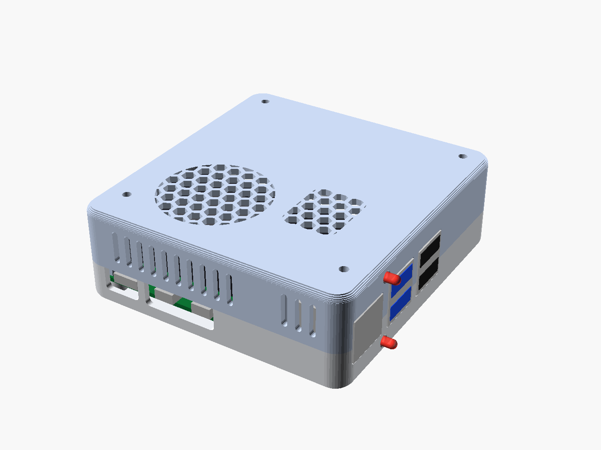
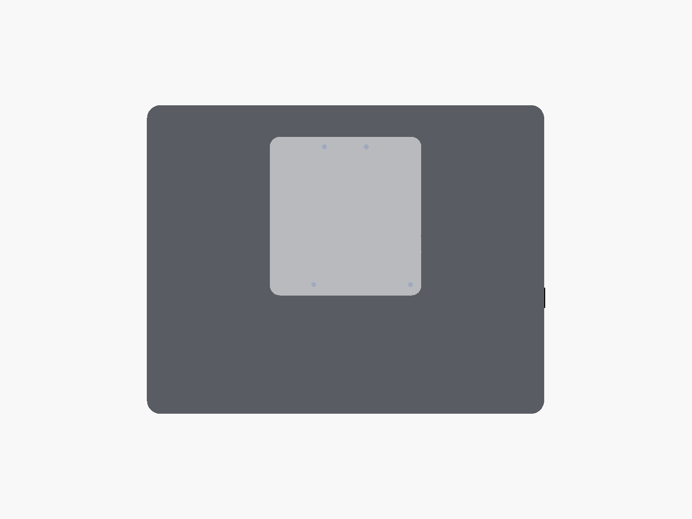
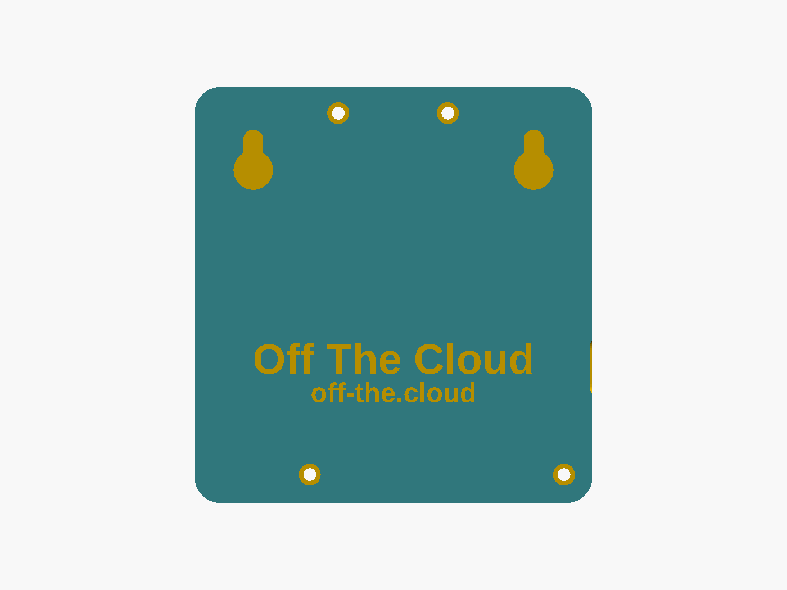
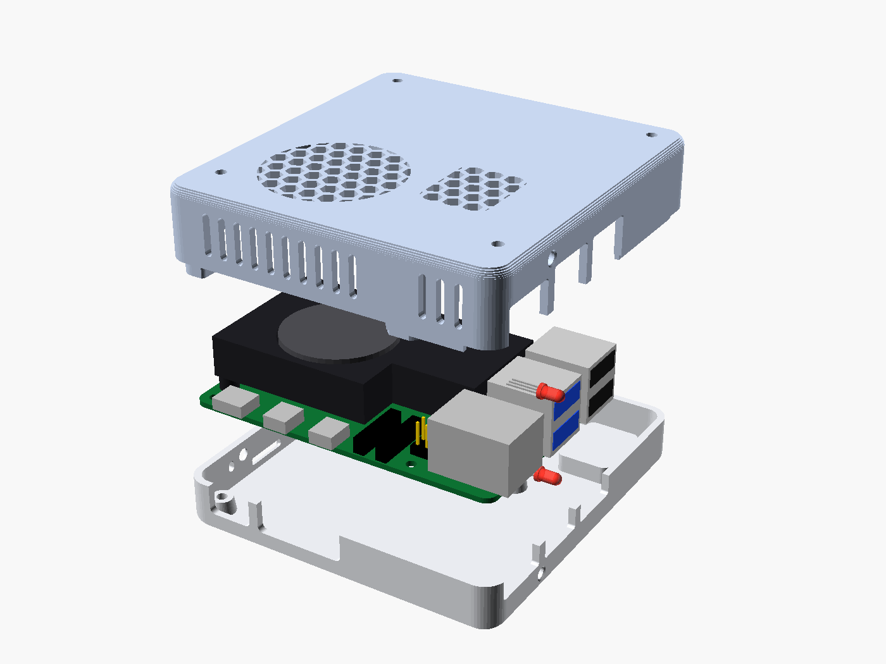
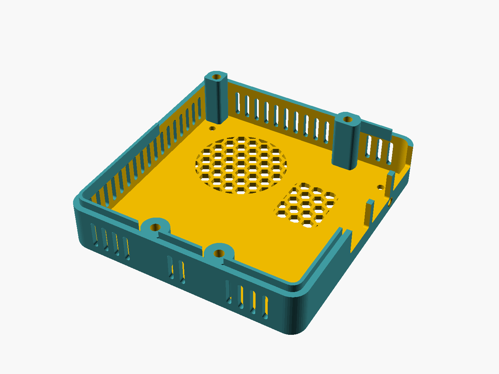

# OTC screen case

A case for the OTC device (Raspberry Pi 5 + GeeekPi/52Pi Armor Lite V5, with its two
status LEDs) that screws onto the back of a portable screen by its four holes (a
75 x 75 mm square, M2.5) and hangs on the wall by two keyholes. The Pi's HDMI goes to the
screen by a short cable. It shares the Pi model, the port cut-outs, the LEDs, the
standoffs, the front lid bosses and the screws with the [cloud case](../cloud-case/).

It fits portable screens with four M2.5 holes in a 75 x 75 mm square on the back (the small
VESA pattern), such as the 9.7-inch HD-97.

| Seen from behind, on an example screen | The wall side: keyholes and text |
|---|---|
|  |  |
| **Exploded: base, Pi 5 + Armor Lite V5, lid** | **The lid as printed, upside down** |
|  |  |

| File | What |
|---|---|
| `otc-screen-case.scad` | Parametric OpenSCAD source (every size is a named variable at the top) |
| `otc-screen-case-base.stl` | Base, in printing orientation (upright, floor on the bed) |
| `otc-screen-case-lid.stl` | Lid, in printing orientation (upside down, top on the bed) |
| `otc-screen-case-spacers.stl` | The four spacers between the lid and the screen |
| `otc-screen-case-test-keyhole.stl` | One keyhole, to try your wall screw first (~10 min) |
| `render.sh` | Regenerates the STLs, the PNGs and the interference checks |
| `view-*.png` | `iso`, `on-screen` (seen from behind, with an estimated stand-in for the screen), `wall-side` (keyholes and text), `base-inside`, `lid-print`, `exploded`, `cut-front`, `cut-keyhole`, `cut-usb` (the LEDs), `test-keyhole` |

Outside size: **90.8 x 95 x 31.9 mm**, plus the 3 mm spacers: the screen stands 35 mm off
the wall.

## How it goes together

From the wall: the **base** (its floor flat on the wall, with the two keyholes and
**"Off The Cloud"** and **off-the.cloud** debossed in it), the Pi, the **lid** (its top towards the screen), the
**spacers**, the screen.

The screen hangs landscape, and the case sits turned on its holes so that the part of
the case behind the board is at the top. Seen from behind:

* **up:** the back of the case, with the two keyholes inside it (there's no board there,
  so they fit side by side in the floor);
* **down:** the USB-C/HDMI side: the power and HDMI cables hang straight down, and the
  screen's HDMI port is close, on its right edge a little lower;
* **left:** the USB/Ethernet end, with the two status LEDs, as on the cloud case;
* **right:** the microSD end (card slot, power button, the board's own status LED).

The case is centred on the screen's four holes, in the upper half of the screen, hidden
behind it.

* **The lid stays on the screen.** It is screwed to it from inside, through its top and a
  3 mm spacer at each hole: **4 x M2.5x8**, 3 mm into the screen's holes. The spacers keep
  a 3 mm gap between the lid and the screen; the cooler's fan draws its air through it
  (the grille over the fan faces the screen), and the warm air leaves through slots in
  the lid's walls, the top ones above all.
* **The base carries the Pi.** Its two back screws go in from above into inserts in the
  back standoffs (**2 x M2.5x6**), as in the cloud case.
* **The base closes onto the lid** with four screws from the wall side, all **M2.5x8**: two
  up through the front standoffs and the Pi's front holes into the lid's front bosses, and
  two through pillars at the top, between the keyholes, into the lid's back bosses. The
  case opens (and the Pi comes out) without touching the screen: the lid stays on it.
* **The keyholes** are side by side, **64 mm apart**, 32.5 mm above the centre of the
  screen's four holes: well above the screen's weight, so the case hangs straight and
  its bottom rests on the wall. Each takes a screw with a head up to 9 mm across and
  3.5 mm tall and a shank up to 4.5 mm; the head goes into the big hole and the case drops
  7 mm onto it.
* **The LEDs** are the cloud case's: two 3 mm round bi-colour LEDs on the line of the gap
  between the Ethernet jack and the blue USB stack, the upper one in the lid's end wall
  above the ports (the top blue port's), the lower one in the base's end wall below them,
  at the height of the space under the board (the bottom blue port's).
* **The text**, "Off The Cloud" and off-the.cloud under it, is debossed 0.7 mm into the
  floor, mirrored so it reads right from behind (`text_on`, `url_on`).

Everything else is as in the cloud case: the front lid bosses (rounded blocks ending
1.5 mm above the board), the tapered standoffs (7.2 to 6 mm), the ports' openings, the
alignment lip.

## Hardware

* 6 x M2.5x4 heat-set inserts (ø3.6 holes; set `insert_d` to your maker's hole size): two in
  the base's back standoffs, four in the lid (two front bosses, two back bosses)
* M2.5 screws, socket or button head: 2 x M2.5x6 and 8 x M2.5x8
* 2 wall screws (heads up to 9 mm, shank up to 4.5 mm) with plugs for your wall
* 2 x 3 mm round bi-colour red/green LEDs, common cathode (3 leads), 4 resistors 330-470 Ω,
  DuPont female jumper wires (thin wire for the lower LED's run under the board), heat-shrink
* a short micro-HDMI to (mini-)HDMI cable for the screen (check its port), ~20-30 cm; one
  with an angled plug at the screen sticks out less at its side

## Assembly

1. Press the inserts in with a soldering iron, each flush: two into the base's back
   standoffs; with the lid upside down, two into its front bosses (the blocks by the
   USB-C/HDMI wall, from their ends) and two into its back bosses (from the joint side).
2. Lay the screen face down on something soft. Put the lid on its back, open side up, over
   the four holes, with a spacer under each hole, and drive the 4 x M2.5x8 from inside the
   lid. The lid's USB-C/HDMI wall goes towards the screen's bottom edge, its microSD end
   towards the screen's port edge.
3. Push the upper LED into its hole in the lid's end wall from inside (dome out, flange in
   the counterbore) and glue it; bend its leads back.
4. Make up the LEDs with their resistors and wires. Push the lower LED into its hole in the
   base's end wall from inside and glue it; lay its wires along the floor towards the GPIO
   side. Fit the Armor Lite to the Pi, take the microSD card out, lower the Pi into the
   base, bring the LED's wires up past the board's GPIO edge, drive the two back M2.5x6 and
   plug the lower LED on the header.
5. Hold the base over the lid, plug the upper LED on the header with some slack, turn the
   base over onto the lid (the Pi goes in upside down, its ports into the lid's notches)
   and drive the 4 x M2.5x8 from the base's floor.
6. Slide the microSD card in, plug the cables in, and hang it: two wall screws 64 mm apart
   at the same height (a spirit level), their heads ~3 mm out of the wall. The centre of
   the screen ends up about 62 mm below the screws, midway between them.

## On the wall

Once hung and plugged in, the screen shows the device's web app, full-screen, with an
on-screen keyboard if it's a touch screen ([A screen on the device](../../README.md#a-screen-on-the-device) in the
main README: a Raspberry Pi with 4 GB of memory or more; the browser is installed the first
time, a few minutes). For the touch, a second cable: USB-A from one of the Pi's black USB 2
ports (the blue ones are the disks') to the screen's touch/USB-C port - a data cable, not a
charge-only one. Power the screen from its own 5 V / 3 A supply rather than the Pi: the Pi's
USB ports share 1.6 A with the disks.

**"No signal" from the screen:** the Pi looks for a screen once as it starts, and a portable
screen still waking up then can be missed. The device asks again every 10 seconds, so turning
the screen off and on usually brings the picture; if not, restart the Pi with the screen
already on. A screen that is never found at all can be forced on: add
` video=HDMI-A-1:1280x720@60D` to the end of the single line in `cmdline.txt` on the microSD
card's `bootfs` (`HDMI-A-1` is the port next to the power input; `HDMI-A-2` the other one).
The device then shows itself whether or not a screen is there.

## Printing

As the cloud case: PETG, 0.2 mm layers, 4 perimeters, 20 % gyroid, **no supports** (the
keyholes' pockets are 9.5 mm bridges; the text is on the bed side). Base upright, lid upside
down, spacers flat.

## Check first

1. **The screen's holes:** an M2.5x8 goes 3 mm into them through the lid's 2 mm top and a
   3 mm spacer. Screw an M2.5 into one by hand and see how deep it goes: if less than 3 mm,
   print thinner spacers (`spacer_h`); never screw deeper than the hole.
2. **Your wall screw:** print `otc-screen-case-test-keyhole.stl` and hang it on the screw:
   the head should pass the big hole and hold behind the slot without wobbling out.
   Adjust `key_head_d`, `key_shank_w`, `key_pocket_h` if not.
3. The insert test piece and the USB-end test slice of the [cloud case](../cloud-case/) apply
   here too (same holes, port openings and LED holes).
4. The `on-screen` view's screen is an example 9.7-inch screen (238 x 185 mm, the hole
   square's centre 29 mm above its centre, the HDMI port 52 mm below the square's centre on
   its right edge): only that view uses it. Measure yours and set `screen_size`,
   `screen_c_down`, `screen_hdmi_down` to see where the cable runs.

## Re-rendering

`./render.sh` (OpenSCAD 2025+). It also runs the interference checks: the Pi (with its
LEDs) in the case, the board dropped into the base, the lid lowered onto the board, base
against lid, and the screen's screw heads against everything. Each must come out empty or
as zero-thickness contacts.

## Licence

[CC BY-SA 4.0](../LICENSE.md): print it, change it, share it and sell prints, crediting Off The
Cloud ([off-the.cloud](https://off-the.cloud)); share what you change under the same licence.
